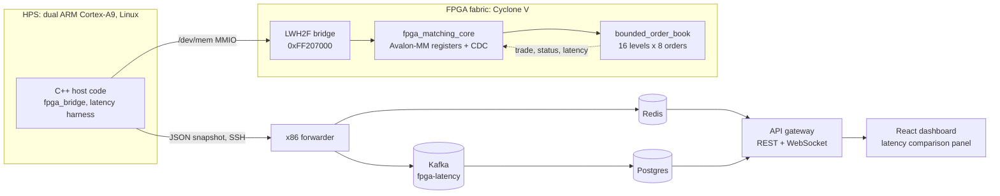
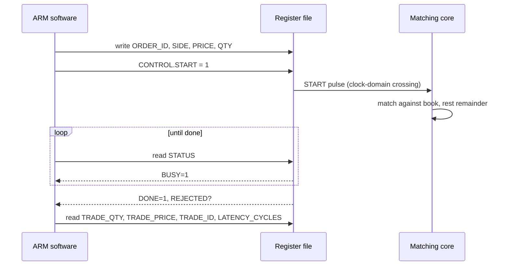
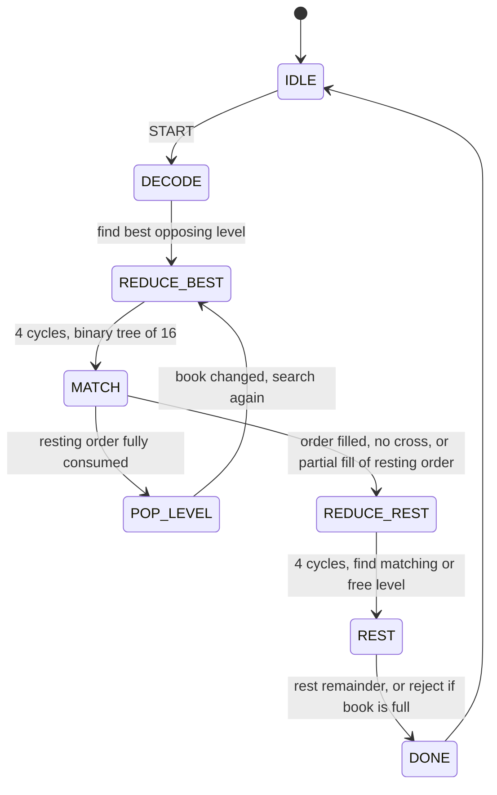
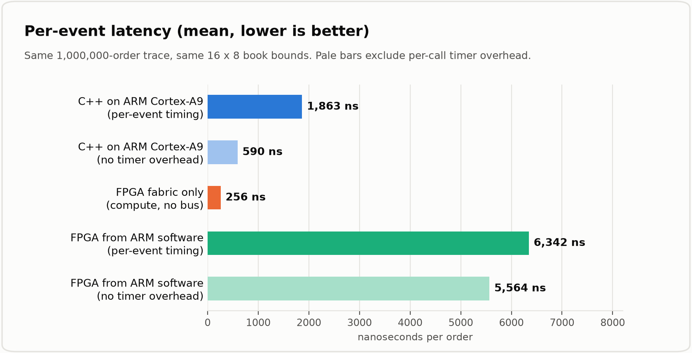
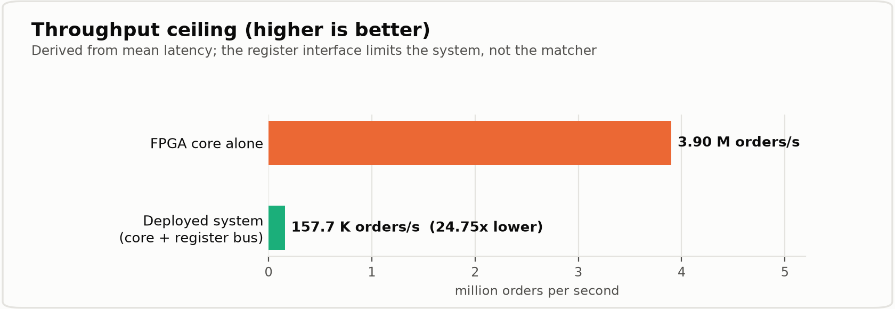
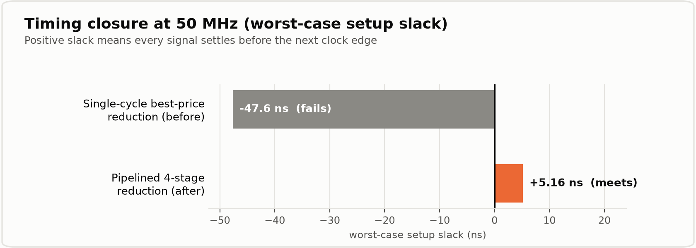
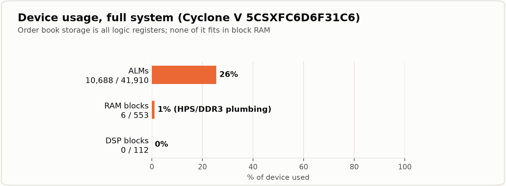

# FPGA Trade Matching Engine

A limit-order matching engine in hand-written SystemVerilog (no HLS), running on an Intel DE10-Standard board (Cyclone V SoC, `5CSXFC6D6F31C6`). It is the hardware counterpart to [Low-Latency-Trading-Exchange](https://github.com/Nukebyt/Low-Latency-Trading-Exchange), a C++ trading stack whose matching engine uses an unbounded `std::map` book. This repo solves the same matching problem with parallel comparators and measures the result on the board, with nothing simulated or projected.

**Findings in brief**

- The FPGA matcher takes 256 ns per order. The same logic in C++ on the board's ARM cores takes 590 ns without timer overhead, or 1,863 ns with per-event timing, so the fabric is **2.3x to 7.3x faster** depending on which software figure you use.
- Calling it from software costs more than it saves. The full ARM-to-FPGA round trip is **3.4x to 9.4x slower** than pure C++ on the same cores (5,564 ns without timer overhead, 6,342 ns with), because the register interface handles one order at a time.
- The design meets timing at 50 MHz only after pipelining the best-price search. The first version missed by 47.6 ns.

## Architecture

The ARM cores (HPS) run Linux and the C++ host code. They write each order into memory-mapped registers over the lightweight HPS-to-FPGA bridge. The matching core runs in fabric and passes the result back through the same registers.



The right-hand side is the integration with the software project. The ARM harness samples latency continuously and writes a JSON snapshot. An x86 forwarder pulls it over SSH into Kafka and Redis, and the dashboard plots it live next to the software rows. The reference copies of that code are in [`software-integration/`](software-integration/).

### One order, end to end

The core accepts one order at a time. Software writes the five input registers, pulses `START`, polls `BUSY`, then reads the result.



### Inside the matching core

The book is 16 price levels per side, each holding 8 resting orders in a time-priority FIFO. Levels are unordered slots. Finding the best price means comparing all 16 at once, which is the work software does one comparison at a time. The comparison is a four-stage registered tree.



| Register | Dir | Meaning |
|---|---|---|
| `ORDER_ID_LO/HI`, `SIDE`, `PRICE`, `QTY` | W | The order. Price is signed ticks (x10,000). |
| `CONTROL` | W | Bit 0 = START |
| `STATUS` | R | BUSY, DONE, REJECTED |
| `TRADE_QTY`, `TRADE_PRICE`, `TRADE_ID_LO/HI` | R | Total fill and the last fill's price and id |
| `LATENCY_CYCLES` | R | Clock cycles from START to DONE |

The full register map, algorithm notes and clock-domain details are in [`docs/fpga-matching-engine.md`](docs/fpga-matching-engine.md).

## Results

All rows replay the same 1,000,000-order trace (seed 42) against the same 16 x 8 bounds on the same board.

### Latency



| Engine | Where it runs | Mean, per-event timing | Mean, no timer overhead | p50 | p99 | Reject rate |
|---|---|---|---|---|---|---|
| C++, bounded | ARM Cortex-A9 | 1,863 ns | 590 ns | 1,820 ns | 2,760 ns | 72.4% |
| SystemVerilog core | FPGA fabric | **256 ns** (12.8 cycles) | 256 ns | 240 ns | 480 ns | 73.6%* |
| Same core, from software | ARM to bridge to fabric to ARM | 6,342 ns | 5,564 ns | 6,320 ns | 6,420 ns | 73.6%* |

*The two FPGA rows are the same run.

The ARM rows are timed with a clock call around every order. On this board that call is expensive (about 2.5 µs per order for the C++ row, 1.6 µs for the round trip), so the per-event columns, p50 and p99 all include that overhead. The probable cause is a missing fast `clock_gettime` path on this kernel, which I have not confirmed. The "no timer overhead" column is the aggregate time of a run without per-event timing. The fabric row is read from the core's own cycle counter, so it has no such overhead.

Fabric against C++ is the like-for-like comparison. The round trip loses because every order pays for a Linux MMIO write sequence, a bridge crossing and a polling loop, and that cost is larger than the compute the fabric saves.

A desktop x86 build of the software engine runs at about 245 ns per event. That figure is left out of the comparison because it replays a different workload (add, modify and cancel on an unbounded book) on a much faster CPU that never leaves the chip.

### Throughput



The core could take about 3.9 M orders/s. The deployed system manages about 158 K orders/s (about 180 K without timer overhead) because it waits for each order to finish before sending the next. The interface is the bottleneck by 22x to 25x. The obvious fix is a request queue in the register map so several orders can be in flight, which is not built yet.

### Timing



The first version found the best price among 16 levels in a single clock cycle. Quartus built it as a 76-level serial chain, which missed the 20 ns clock period by 47.6 ns. Running static timing analysis exposed this, and it was the real cause of a reject-rate mismatch and a board hang that had been blamed on other things. Pipelining the search into 4 registered stages gives +5.16 ns of slack with zero failing endpoints at every corner, at the cost of 4 extra cycles per search ([bug #13](fpga_docs/bugs.md)).

### Resources



The order book uses no block RAM. Block RAM offers one or two ports, and the design reads all 16 levels every cycle, so Quartus implemented the whole book as logic registers. The 6 RAM blocks in the full system come from the HPS and DDR3 plumbing. The standalone core alone takes 9,040 ALMs (22%).

### Why 72% of orders are rejected

The bounded book rejects an order only when its unfilled remainder needs a new price level and all 16 are taken, or its level already holds 8 orders. A level frees up only when every order at that exact price has been filled, and this version has no CANCEL. As the market price drifts, orders left at old prices are never matched, so those slots stay occupied for the rest of the run. After enough orders, nearly every slot is stuck. Widening the book would only delay this. CANCEL support is the fix, and it is out of scope for this version ([ADR-007](docs/ADR-007-fpga-bounded-order-book.md)).

## Repository layout

```
rtl/                  SystemVerilog source
  bounded_order_book.sv   16-level parallel book, pipelined best-price tree
  fpga_matching_core.sv   Avalon-MM register map, clock-domain crossing
  cdc_pulse_sync.sv       two-flop synchronizer
sim/                  Questa testbenches: 14 directed tests, multi-level sweep,
                      1M-order trace replay against a C++ reference
host/                 C++ for the ARM cores (cross-compiled)
  bounded_matching_engine/  software reference with the same bounds
  fpga_bridge/              /dev/mem driver and benchmark
  fpga_latency_harness/     continuous latency sampler
ip/, soc_system.qsys  Platform Designer component and HPS system
soc_system/, hps_isw_handoff/   generated output, committed (see below)
output_files/         .sof and every fit, timing and assembler report
software-integration/ reference copies of the Kafka/API/dashboard code
docs/, fpga_docs/     design docs, ADR, bug log (13 bugs, each with root cause)
```

`soc_system/` and `hps_isw_handoff/` are tool-generated but committed, because regenerating them hits two Intel toolchain bugs ([#8](fpga_docs/bugs.md), [#9](fpga_docs/bugs.md)). The Quartus project compiles RTL from `soc_system/synthesis/submodules/rtl/`, so keep it in sync with `rtl/` by hand.

## Building

Needs Quartus Prime 21.1 Lite (Cyclone V) and Questa (tested with 2024.1).

**Simulate** (no board needed):

```
cd sim
vsim -c -do sim.do
```

The trace-replay testbenches read `sim/trace.csv`, which is not committed (27 MB, deterministic). Regenerate it with:

```
g++ -O2 -std=c++17 -I host/bounded_matching_engine/include \
    host/fpga_bridge/tools/gen_trace.cpp -o gen_trace
./gen_trace 1000000 sim/trace.csv
```

Then run the wrapper testbench:

```
vlib work
vlog -sv ../rtl/cdc_pulse_sync.sv ../rtl/bounded_order_book.sv ../rtl/fpga_matching_core.sv tb_trace_replay_wrapper.sv
vsim -c work.tb_trace_replay_wrapper -do "run -all"
```

**Compile the board project:**

```
quartus_map DE10_Standard_golden_top
quartus_fit DE10_Standard_golden_top
quartus_asm DE10_Standard_golden_top
quartus_sta DE10_Standard_golden_top
```

After regenerating `soc_system.qsys`, re-run `apply_hps_sdram_pin_assignments.tcl`, or the fitter fails with termination errors (bug #9). Check simulation and `quartus_sta` slack before programming the board.

## Known open items

- Hardware reject rate is about 1 point above the C++ reference (73.4-73.6% vs 72.4%). The RTL matches the reference exactly across all 1M orders in simulation, so the suspect is power-on state on the real board. Details in [`docs/fpga-matching-engine.md`](docs/fpga-matching-engine.md#known-open-gaps).
- `core_clk` and `avs_clk` are separate clock inputs with a real crossing, but both run from the same 50 MHz clock for now.

## Documentation

- [`docs/fpga-matching-engine.md`](docs/fpga-matching-engine.md): scope, register map, algorithm, clock domains, integration
- [`docs/ADR-007-fpga-bounded-order-book.md`](docs/ADR-007-fpga-bounded-order-book.md): the bounded-book decision and what changed during the build
- [`docs/fpga-performance.md`](docs/fpga-performance.md): full measurement tables and method
- [`fpga_docs/bugs.md`](fpga_docs/bugs.md): every bug found, with root cause and fix

## License

No license file yet, matching the upstream software project. Both are educational projects, not production trading systems.
